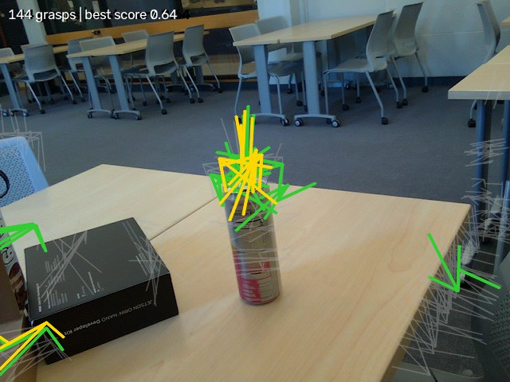
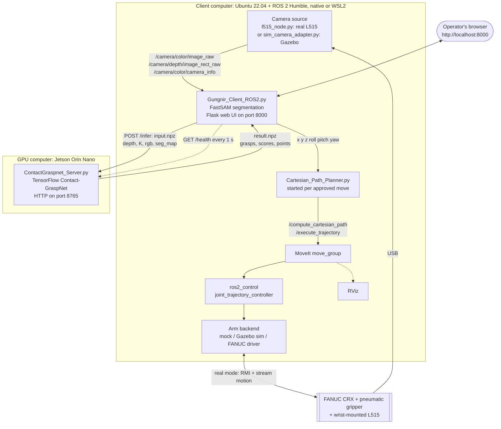
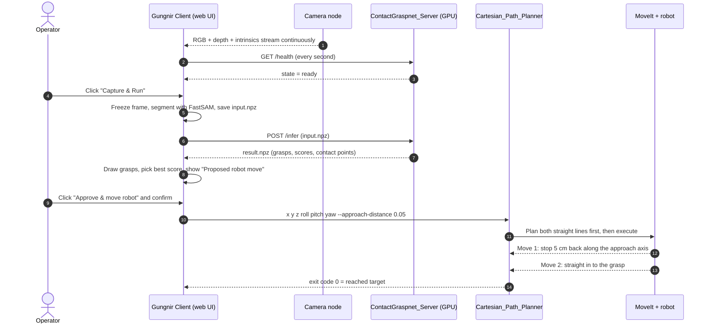
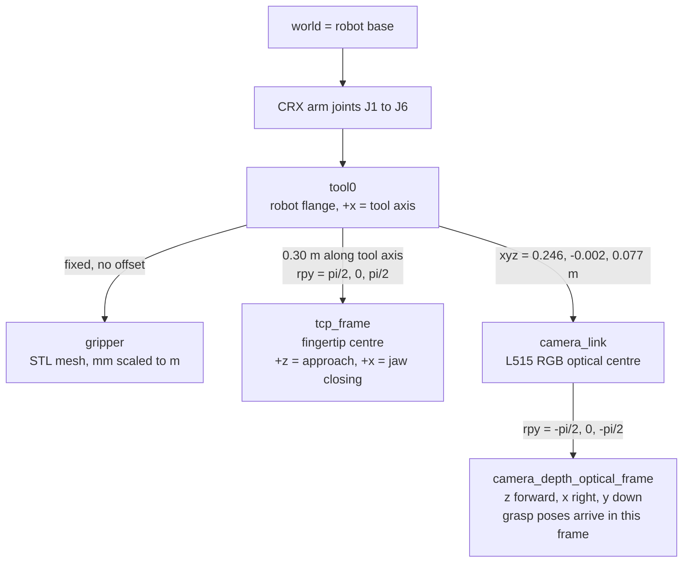

# Gungnir

<details>
<summary><b>AI use statement</b></summary>

This README was restructured and expanded with Claude (Anthropic; Claude Opus 5.5 via claude.ai) in November 2026,
at the author's request. Claude read the repository (`setup.py`, `ContactGraspnet_Server.py`, the launch files,
`Gungnir_Client_ROS2.py`, `Cartesian_Path_Planner.py`, the URDF/xacro geometry and the helper scripts) and wrote the
new sections, the Mermaid diagrams and the run-case examples from what that code does. Every sentence of the
previous README was kept; it now sits in the matching new sections. The gripper dimensions were measured by Claude
from `Pneumatic_Gripper_Test.stl` and agree with the author's stated 24.9 cm jaw opening. Claude checked that the
diagrams render, but did **not** run any of the commands on ROS 2, the Jetson, the camera or the robot.
Reviewed and tested by: not yet reviewed by the author.
</details>

#### In Norse mythology, Gungnir (/ˈɡʌŋ.nɪər/, "the rocker, the swaying one") is the spear of the god Odin. It is known for always hitting the target of the attacker regardless of the attacker's skill.

The goal of this project is to develop a system capable of picking up any object specified by the user with a 6 DOF robot arm
using a depth camera and grasping model. The system will be able to identify the requested item in the frame, compute all possible
ways the object could be grasped, and then pick it up with a physical gripper.

**In one sentence:** an Intel RealSense L515 depth camera on the wrist of a FANUC CRX robot takes a picture,
[Contact-GraspNet](https://github.com/NVlabs/contact_graspnet) running on a GPU computer (a Jetson Orin Nano) proposes
grasps, a browser UI shows them and highlights the best one, and, only after a person clicks **Approve & move
robot**, MoveIt moves the gripper to that grasp in two straight-line steps.



*A real capture from the L515: 144 predicted grasps, best score 0.64. Gold = top 10 % of grasps, green = top 30 %,
grey = the rest. In the live UI the single best grasp (the one proposed to the robot) is drawn in magenta.*

---

## Table of contents

1. [System architecture](#system-architecture)
2. [Getting Started](#getting-started) (requirements, clone, `setup.py`)
3. [Starting the Contact-GraspNet Server and connecting the client](#starting-the-contact-graspnet-server-and-connecting-the-gungnir-client)
4. [Run cases](#run-cases)
   - [Case 1: simulated robot + simulated camera](#case-1-simulated-robot--simulated-camera)
   - [Case 2: mock robot + real camera](#case-2-mock-robot--real-camera)
   - [Case 3: real robot + real camera](#case-3-real-robot--real-camera)
5. [Using the web UI](#using-the-web-ui-every-run-case)
6. [Gripper geometry](#gripper-geometry)
7. [Technical Details](#technical-details) (division of labor, protocol, ROS topics, launch arguments)
8. [Repository layout](#repository-layout)
9. [Troubleshooting](#troubleshooting)
10. [Safety](#safety)
11. [Project status and roadmap](#project-status-and-roadmap)

---

## System architecture

Gungnir is split across **two computers** so the heavy neural network never shares a machine with the robot
software:



**One grasp cycle, start to finish:**



---

## Getting Started

### Important Notes
- **This code is designed to run on two computers. Both must run Linux**
  - One computer with a GPU runs the Contact-Graspnet Server
  - The other computer (with or without a GPU) runs the Gungnir Client
- **Follow the setup instructions below on** ***Both*** **computers**.

### What each computer needs

| | Server (GPU) computer | Client computer |
|---|---|---|
| Tested hardware | NVIDIA Jetson Orin Nano | x86-64 PC (Windows + WSL2 Ubuntu works, see below) |
| OS | JetPack 7.2 (Ubuntu, Python 3.12) | Ubuntu 22.04 (ROS 2 Humble). `setup.py` also knows Ubuntu 24.04 / Jazzy, but the FANUC driver branch in `ws_fanuc` targets Humble |
| What `setup.py` does there | Installs the Jetson GPU builds of TensorFlow and PyTorch, legacy Keras (`tf-keras`), and compiles Contact-GraspNet's PointNet2 CUDA operators | Installs ROS 2, the Python packages, the L515 wrapper, and builds the `ws_fanuc` ROS 2 workspace with `rosdep` + `colcon` |
| Skipped there | The ROS 2 workspace build (ARM64 is detected automatically) | TensorFlow CUDA-op compilation |
| Peripherals | Network only | Intel RealSense L515 (USB 3), network to the server, network to the robot controller |

The model checkpoint (`contact_graspnet/checkpoints/scene_test_2048_bs3_hor_sigma_0025`) is already in the
repository, so there is no separate download step. The FastSAM weights (`FastSAM-s.pt`) are also included next to
the client; if they are ever missing, Ultralytics downloads them the first time the client runs (internet needed).

### First clone this repository.

```
git clone https://github.com/jcsnyds/Gungnir.git
cd Gungnir
```

> The launch file looks for the client in `~/Gungnir/...` first, so cloning into your home folder is the simplest
> choice. Other locations also work: the launch file finds the scripts from the workspace it was built in.

### Then run the setup script on both computers

`python setup.py`

Follow any prompts given to install the necessary packages and software. **This setup will likely take a long time**

On Ubuntu, `python` may not exist; use `python3 setup.py` in that case. You will be asked for your `sudo`
password (apt packages, `rosdep`). What the script does, in order:

1. **ROS 2 (client, Linux only):** adds the ROS apt repository, installs ROS 2 Humble (Ubuntu 22.04) or Jazzy
   (Ubuntu 24.04) if missing, and checks that ROS Python and `cv_bridge` work.
2. **Virtual environment:** reuses an active one, or a project-local `.venv/` / `venv/`, or creates `.venv/`, then
   re-runs itself inside it.
3. **RealSense L515 wrapper:** runs `IntelRealsense_Driver/setup.py` (native L515 support).
4. **Python packages** from `requirements.txt` / `constraints.txt`. On the Jetson it first swaps in GPU builds of
   PyTorch and TensorFlow, then compiles Contact-GraspNet's TensorFlow CUDA ops.
5. **ROS 2 workspace (client only):** `rosdep install` + `colcon build --symlink-install` in `ws_fanuc/`, then
   checks that `ros2` can find the `gungnir` package.
6. **Smoke tests:** checks that the main imports (and the GPU, on the Jetson) work.

Useful options (all optional):

| Option | Use it when |
|---|---|
| `--skip-realsense` | The computer has no L515 attached (e.g. the Jetson) |
| `--skip-verify` | You only want to install, without the final smoke tests |
| `--skip-tf-ops` | Re-running on the Jetson after the CUDA ops are already compiled |
| `--skip-ros-setup` | You manage ROS 2 yourself (advanced) |
| `--skip-ros-build` | Do not build `ws_fanuc` |
| `--skip-rosdep` | `rosdep install` fails on a package you do not need (see [Troubleshooting](#troubleshooting)) |
| `--clean-ros-build` | Delete `ws_fanuc/build`, `install`, `log` and rebuild from scratch |
| `--force-ros-build` | Build `ws_fanuc` on an ARM64 computer anyway |

**Example: a typical first install**

```bash
# Client computer
cd ~/Gungnir
python3 setup.py                       # takes a long time on a fresh install

# Server computer (Jetson), no camera attached
cd ~/Gungnir
python3 setup.py --skip-realsense
```

When the client build finishes it prints the commands to use the workspace. Open a **new** terminal for them (the
`.venv` does not need to be activated for `ros2 launch`; the launch file picks the venv's Python for the client
itself):

```bash
source /opt/ros/humble/setup.bash
source ~/Gungnir/ws_fanuc/install/setup.bash
```

> **Tip:** add those two `source` lines to the end of `~/.bashrc` on the client so every terminal is ready.

### Client on Windows (WSL2), optional

The client has been run inside WSL2 Ubuntu 22.04 on a Windows PC. Two extra steps are needed:

1. **Pass the L515 through to WSL** with [usbipd-win](https://github.com/dorssel/usbipd-win), from an
   *administrator* PowerShell on Windows:
   ```powershell
   usbipd list                          # find the BUSID of the Intel RealSense L515
   usbipd bind   --busid <BUSID>        # one time
   usbipd attach --wsl --busid <BUSID>  # after every replug / reboot
   ```
2. **Open the web UI** in a Windows browser at `http://localhost:8000` (WSL2 forwards localhost).

---

## Starting the Contact-GraspNet Server and connecting the Gungnir Client

### Network between the two computers

The client must be able to reach the server on TCP port **8765**. Either of these has been used:

- **Direct Ethernet cable** between the two computers. Give both ends static addresses on the same subnet,
  for example Jetson `192.168.137.2`, client PC `192.168.137.1` (netmask `255.255.255.0`).
- **The same Wi-Fi / LAN.** The address the server prints at start-up works as-is.

Check the link from the client before launching anything:

```bash
ping <server ip>
curl http://<server ip>:8765/health     # once the server is running; prints {"state": "ready", ...}
```

### **On the Server computer**
- Connect the Server computer to the Client computer with an Ethernet cable. Then ssh into the Server and run the following command.

`python ContactGraspnet_Server.py`

This will output the Server's IP address to be used in the next step.

The server needs the environment created by `setup.py`, so in practice the full sequence is:

```bash
ssh <user>@<server ip>
cd ~/Gungnir
source .venv/bin/activate
python ContactGraspnet_Server.py
```

**Example output** (the model takes a while to load the first time):

```text
[server] listening on port 8765. On the camera computer (ROS 2 workspace sourced) run:
         ros2 launch gungnir gungnir.full.launch.py grasp_server:=192.168.137.2 mode:=real
         (to test in simulation instead:  ros2 launch gungnir gungnir.full.launch.py grasp_server:=192.168.137.2 mode:=sim)
[server] no token set: anyone who can reach this port can use the GPU (fine on a private LAN).
...
[server] model ready
```

Leave this terminal open. Server options:

| Option | Default | Meaning |
|---|---|---|
| `--port` | `8765` | TCP port. With a non-default port, pass it to the client too: `grasp_server:=<ip>:<port>` |
| `--host` | `0.0.0.0` | Bind address |
| `--token` | `$GUNGNIR_TOKEN` | Shared secret. The client must have the same value in `GUNGNIR_TOKEN` |
| `--forward-passes` | `5` | More passes = more grasp candidates (and slower inference) |
| `--ckpt-dir` | `contact_graspnet/checkpoints/scene_test_2048_bs3_hor_sigma_0025` | Model checkpoint |
| `--no-launch-blocking` | off | Do not set `CUDA_LAUNCH_BLOCKING=1` |

If inference ever fails (for example a sticky CUDA error), the server restarts itself automatically in the same
terminal; the client notices and carries on.

> **Running it as a service:** because the server restarts itself with `os.execv` (same process ID), it also works
> under `systemd` if you want it to start at boot.

### **On the Client computer**
- Plug in the Intel Realsense L515 to a USB port then run the following command using the IP Address found from the step above.

```
source /opt/ros/humble/setup.bash
source ~/Gungnir/ws_fanuc/install/setup.bash

ros2 launch gungnir gungnir.full.launch.py mode:=sim camera:=sim grasp_server:=<gpu ip address>
```

The command above is the fully simulated case. `mode:=` selects the robot and `camera:=` the camera, as shown in
[Run cases](#run-cases). `grasp_server:=` is how the client is pointed at the server; it accepts `192.168.1.50`,
`192.168.1.50:8765` or `http://192.168.1.50:8765`. If the server uses a token:

```bash
export GUNGNIR_TOKEN=<your token>    # before ros2 launch; deliberately not a launch argument (visible in `ps`)
```

Then open **<http://localhost:8000>** in a browser on the client computer. The top bar shows the server state:
*starting* → *ready* (green) once the model has loaded. If it never leaves *starting*, see
[Troubleshooting](#troubleshooting).

---

## Run cases

Everything is started by one launch file. Two arguments pick the hardware:

| Run case | `mode:=` (robot) | `camera:=` | Needs |
|---|---|---|---|
| **1. Full simulation** | `sim` (Gazebo, physics) | `sim` (Gazebo depth camera + noise model) | Server only |
| **2. Mock robot, real camera** | `mock` (ros2_control mock, no physics) | `real` (L515 through `l515_node.py`) | Server + L515 |
| **3. Real robot, real camera** | `real` (FANUC ROS 2 driver) | `real` | Server + L515 + robot controller |

`camera:=auto` (the default) picks `sim` for `mode:=sim`, `real` for `mode:=real` and `none` for `mode:=mock`, so
**always pass `camera:=real` with `mode:=mock`**: with no camera the Capture button stays disabled.

What each case starts:

| Component | sim | mock | real |
|---|:---:|:---:|:---:|
| Gazebo server (`ign gazebo`, headless) | ✅ | | |
| `ros2_control_node` (FANUC controller config) | | ✅ | ✅ |
| `joint_state_broadcaster`, `joint_trajectory_controller` | ✅ | ✅ | ✅ |
| `fanuc_gpio_controller` | stub | stub | ✅ real |
| MoveIt `move_group` + RViz | ✅ | ✅ | ✅ |
| `sim_camera_adapter.py` | with `camera:=sim` | | |
| `l515_node.py` | | with `camera:=real` | with `camera:=real` |
| `camera_viz.py` (point cloud + colour-coded depth for RViz) | ✅ | ✅ | ✅ |
| `world_markers.py` (sim objects in RViz) | ✅ | | |
| Gungnir client web UI (`gungnir.full.launch.py` only) | ✅ | ✅ | ✅ |

Every case starts the same way:

1. Start the server and wait for `[server] model ready`.
2. In a new terminal on the client, source ROS 2 and the workspace (see above).
3. Run the launch command for the case.
4. Open <http://localhost:8000>, click **Capture & Run**, inspect the grasps, then approve the move (or not).

### Case 1: simulated robot + simulated camera

No hardware except the GPU server. Gazebo simulates the CRX arm and a depth camera on its wrist, looking at a table
with five randomly placed objects (a can, a bottle, a box, a block and a ball). Use this first to check that everything is wired correctly,
and before trying anything new on the real robot.

```bash
ros2 launch gungnir gungnir.full.launch.py mode:=sim camera:=sim grasp_server:=<gpu ip address>
```

**Example: a full simulated pick, step by step**

```bash
# Terminal 1: Jetson
ssh <user>@192.168.137.2
cd ~/Gungnir && source .venv/bin/activate
python ContactGraspnet_Server.py                     # wait for "[server] model ready"

# Terminal 2: client
source /opt/ros/humble/setup.bash
source ~/Gungnir/ws_fanuc/install/setup.bash
ros2 launch gungnir gungnir.full.launch.py mode:=sim camera:=sim grasp_server:=192.168.137.2
```

1. RViz opens with the arm in its home pose, the camera's coloured point cloud and the sim objects.
   The launch prints `[gungnir] Starting the Gungnir client; web page: http://localhost:8000`.
2. In the browser the live RGB and depth views of the table appear; the server pill turns green (*ready*).
3. Click **Capture & Run**. After a few seconds the grasps are drawn on the image and in the 3D scene, with the
   best grasp in magenta and a **Proposed robot move** panel showing the target pose.
4. Click **Approve & move robot** and confirm the dialog. In RViz the arm first stops 5 cm short of the grasp,
   then moves straight in. The planner's output appears in the page; it should end in success.

Useful options for this case:

```bash
# Show the Gazebo GUI too (software rendered: slow, may crash; the server keeps running if it does)
ros2 launch gungnir gungnir.full.launch.py mode:=sim camera:=sim grasp_server:=<ip> gazebo_gui:=true

# Perfect depth images instead of the L515-like noise model
ros2 launch gungnir gungnir.full.launch.py mode:=sim camera:=sim grasp_server:=<ip> depth_noise:=false

# Give Gazebo time to come up before the client starts
ros2 launch gungnir gungnir.full.launch.py mode:=sim camera:=sim grasp_server:=<ip> client_delay:=20
```

To make a different table scene, regenerate the world (it also writes the ground truth to
`worlds/gungnir_world_truth.yaml`), then relaunch:

```bash
cd ~/Gungnir/ws_fanuc/src/gungnir
python3 scripts/make_world.py --seed 7 --count 6
```

<!-- TODO: add a screenshot of the simulated run, e.g. docs/images/sim_run.png -->

### Case 2: mock robot + real camera

Real L515 images, but the robot is a `mock_components/GenericSystem`: it simply "arrives" at every commanded joint
position, so you can test perception, grasp quality and the whole approval flow at a desk, with nothing moving.

```bash
ros2 launch gungnir gungnir.full.launch.py mode:=mock camera:=real grasp_server:=<gpu ip address>
```

**Example: checking grasps on real objects at a desk**

```bash
# (On WSL: usbipd attach --wsl --busid <BUSID> first, from Windows)
ros2 launch gungnir gungnir.full.launch.py mode:=mock camera:=real grasp_server:=192.168.137.2
```

1. The launch prints `[gungnir] L515 wrapper: .../IntelRealsense_Driver/python` (found automatically).
2. Point the L515 at a few objects 0.3–1 m away. In the browser, check the live depth view looks sensible.
3. Click **Capture & Run**. The result looks like the image at the top of this README; each run is saved to
   `ws_fanuc/src/gungnir/scripts/output/runs/<date-time>/` (`input.npz`, `result.npz`, `overlay.jpg`, `meta.json`).
4. Optionally click **Approve & move robot**: the mock arm moves in RViz only. Because the camera is not really
   on the moving arm here, this checks the plan, not where the real gripper would end up.

Useful options for this case:

```bash
# Colours look blue-ish? swap red and blue
ros2 launch gungnir gungnir.full.launch.py mode:=mock camera:=real grasp_server:=<ip> camera_swap_rb:=true

# The wrapper lives somewhere else
ros2 launch gungnir gungnir.full.launch.py mode:=mock camera:=real grasp_server:=<ip> l515_path:=/path/to/python

# No camera at hand: replay a frame saved by scripts/camera_snapshot.py (depth.npy, k.npy, optional rgb.npy)
ros2 launch gungnir gungnir.full.launch.py mode:=mock camera:=real grasp_server:=<ip> fake_camera_dir:=/path/to/capture
```

### Case 3: real robot + real camera

> ⚠️ **This moves a real robot.** Run the same scene in Case 1 first, keep the emergency stop within reach,
> start with a low speed, and keep people out of the robot's reach. See [Safety](#safety).

**Before the first run:**

1. Set up the FANUC controller for the ROS 2 driver (controller software options, network, RMI and stream motion)
   as described in the
   [FANUC ROS 2 Driver documentation](https://fanuc-corporation.github.io/fanuc_driver_doc/humble/).
   The driver source is in `ws_fanuc/src/fanuc_driver` (Humble branch).
2. Put the client computer on the robot controller's network and check `ping <robot ip>`.
3. Make sure `robot_model:=` matches your arm (default `crx30ia`, see [Launch arguments](#launch-arguments)).
4. Mount the L515 and gripper as in [Gripper geometry](#gripper-geometry); the camera pose in the URDF must match the
   real mount or every grasp will be offset.

```bash
ros2 launch gungnir gungnir.full.launch.py mode:=real camera:=real robot_ip:=<robot ip> grasp_server:=<gpu ip address>
```

**Example: first real pick, slow**

```bash
ros2 launch gungnir gungnir.full.launch.py mode:=real camera:=real \
    robot_ip:=192.168.1.100 grasp_server:=192.168.137.2 \
    client_args:="--move-speed 0.05 --min-score 0.4"
```

1. RViz shows the arm in its **real** current pose (from the controller), with the live point cloud attached to
   the wrist camera.
2. Jog the robot so the camera looks down at the objects from 0.3–1 m.
3. Click **Capture & Run** and check the magenta grasp in the 3D view: is it on the object, and is the approach
   free of the table and other objects?
4. Approve only if it looks right. The proposal expires after 120 s (`--approval-timeout`), because a grasp is only
   valid for the arm pose at the moment of capture. Do not jog the robot between capture and approval.
5. The arm stops 5 cm back along the approach axis, then moves straight in to the grasp.

`--move-speed 0.05` scales velocity and acceleration to 5 %; `--min-score 0.4` refuses to propose any grasp scoring
below 0.4. Raise the speed only once the motion looks right.

---

## Using the web UI (every run case)

| Element | What it does |
|---|---|
| Status pills (top bar) | Camera and server state (*starting* / *ready* / *busy*), restarts counted |
| Live RGB + depth | The camera stream (depth colour-coded between `--min-depth` and `--max-depth`) |
| Prompt box | Saved with each capture in `meta.json`; **not used by the model yet** |
| **Capture & Run** | Freezes the current frame, segments it with FastSAM, sends it to the server |
| 2D overlay + 3D scene | All grasps (gold / green / grey tiers) and the best grasp in magenta |
| Output window | `http://localhost:8000/?view=results`: a second window that follows the latest result |
| **Proposed robot move** | Target pose of the best grasp: x y z (m), roll pitch yaw (rad), in `camera_depth_optical_frame` |
| **Approve & move robot** | Starts `Cartesian_Path_Planner.py` (one approval per proposal) and streams its output |

The web page binds to `localhost` only and has no login, because it can move a robot. To see it from another
computer, tunnel it instead of exposing it: `ssh -L 8000:localhost:8000 <user>@<client computer>`, then browse to
`http://localhost:8000`.

Client options can be passed through the launch file with `client_args:="..."`:

| Client option | Default | Meaning |
|---|---|---|
| `--min-depth` / `--max-depth` | `0.1` / `9` m | Depth crop sent to the model and depth colour range |
| `--min-score` | `0.0` | Do not propose a move if the best grasp scores lower |
| `--move-speed` | `0.2` | Velocity/acceleration scaling, 0 < x ≤ 1 |
| `--approach-distance` | `0.05` m | Stop this far back along the approach axis first (0 = straight in) |
| `--approval-timeout` | `120` s | How long a proposal can be approved |
| `--move-eef` / `--move-group` | `tcp_frame` / `manipulator` | Link that is moved, MoveIt planning group |
| `--move-frame` / `--move-fixed-frame` | `camera_depth_optical_frame` / `base_link` | Frame of the grasp poses, frame fixed to the base |
| `--stream-fps` | `15` | Live-view rate; lower it over a slow link |
| `--swap-rb` | off | Swap red/blue of the live view |
| `--output-dir` | `scripts/output/runs` | Where captures and results are saved |

**Testing a move by hand** (no client needed, `move_group` must be running):

```bash
ros2 run gungnir Cartesian_Path_Planner.py                        # 1 cm along the camera's z axis
ros2 run gungnir Cartesian_Path_Planner.py 0.05 0 0               # 5 cm along x, same orientation
ros2 run gungnir Cartesian_Path_Planner.py x y z roll pitch yaw   # absolute pose (m, rad)
```

---

## Gripper geometry

Gungnir's gripper is **not** the gripper Contact-GraspNet was trained with, so every predicted grasp is converted
before it is sent to the robot. This section explains both grippers and that conversion.

### The two grippers

| | Contact-GraspNet's training gripper | Gungnir's pneumatic gripper |
|---|---|---|
| Model | Franka Emika Panda hand | Custom parallel pneumatic gripper (`CAD/`, mesh `config/meshes/Pneumatic_Gripper_Test.stl`) |
| Maximum opening | 0.08 m (`gripper_width` in the model config) | 0.249 m between the jaws at the fingertips |
| Base → fingertip centre | 0.1034 m | 0.30 m (flange `tool0` → `tcp_frame`) |
| Overall size (mesh bounding box) | – | 0.33 m wide × 0.30 m long × 0.12 m deep |
| Actuation | electric | pneumatic, through the FANUC controller's digital outputs (`fanuc_gpio_controller`) |

The Panda numbers come from `contact_graspnet/gripper_control_points/panda_gripper_coords.yml`; Gungnir's from the
STL mesh and `gungnir_geometry.urdf.xacro`.

### Contact-GraspNet's grasp frame

Each grasp the server returns is a 4×4 pose matrix in the camera frame:

```text
              approach (+z)
                   ▲
                   │      fingertip centre, 0.1034 m along +z
             ┌─────●─────┐ ◄── contact points lie on this line
             │           │
             │     ▲     │
             └─────┼─────┘
                   │
    closing (+x) ◄─●─►      origin = BASE of the Panda hand (not the fingertips)
```

- **origin** = the base of the Panda hand
- **+z** = approach direction (the way the fingers travel toward the object)
- **+x** = closing direction (the line between the two contact points)

### Gungnir's frames (`ws_fanuc/src/gungnir/config/gungnir_geometry.urdf.xacro`)



- **`tool0`**: the FANUC flange. Its +x axis is the tool axis.
- **`gripper`**: the gripper mesh, fixed directly to the flange.
- **`tcp_frame`**: the tool centre point at the **centre between the fingertips**, 0.30 m out along the tool axis.
  Its +z is the tool / approach axis and its +x the jaw closing direction, the same convention as
  Contact-GraspNet's grasp frame (checked in RViz).
- **`camera_link` → `camera_depth_optical_frame`**: the L515's colour lens, 246.2 mm along the tool axis and
  77.5 mm toward the camera side. The numbers come from the Onshape model (depth origin 4.5 mm behind the glass,
  per the L515 datasheet) plus this camera's factory depth-to-colour extrinsics. Depth is aligned to colour in
  `l515.py`, so this frame marks the RGB lens even though its name says "depth". **If the camera is swapped,
  re-measure its extrinsics and update the `l515_mount_joint` origin.**

### From a predicted grasp to a robot target

Because the axes already agree, the conversion is a pure translation of 0.1034 m along the approach axis, from the
Panda base to the fingertip centre (`TCP_IN_GRASP` in `Gungnir_Client_ROS2.py`):

```text
T_target = T_grasp · TCP_IN_GRASP          TCP_IN_GRASP = | 1 0 0  0      |
                                                          | 0 1 0  0      |
                                                          | 0 0 1  0.1034 |
                                                          | 0 0 0  1      |
```

`T_target` is turned into `x y z roll pitch yaw` (fixed-axis RPY, `R = Rz(yaw)·Ry(pitch)·Rx(roll)`) and handed to
`Cartesian_Path_Planner.py` with `--eef tcp_frame --frame camera_depth_optical_frame`. In simulation, leaving out
this offset made the TCP stop exactly 10.3 cm short of the object, which is how it was validated.

**Approach move:** the planner first converts the target into `base_link` (the camera moves with the arm, so a
camera-frame target would otherwise move during the first motion), then makes two straight-line moves:

```text
     current pose ──move 1──► approach point ──move 2──► grasp
                              (target, 0.05 m back          (fingertip centre
                               along its own −z)             on the object)
```

Both segments are planned before anything moves, so a grasp whose last centimetres are unreachable is refused up
front.

### Consequences worth knowing

- **Width:** Contact-GraspNet only predicts grasps up to 8 cm wide. Gungnir's jaws open to 24.9 cm, so every
  predicted grasp fits between them, but objects wider than 8 cm will not get grasps across their full width.
- **Collisions:** Contact-GraspNet rejects grasps that would collide *for a Panda hand*. Gungnir's fingers are much
  longer and wider, so a grasp that is clear for a Panda can still hit neighbouring objects or the table. Check the
  3D view before approving.
- **Planning scene:** the objects to be grasped are deliberately **not** added to MoveIt's planning scene (a grasp
  needs contact, and the sim cannot check gripper–object collisions). MoveIt therefore avoids the robot's own links
  and the camera housing, but not the objects.
- **Gripper actuation:** in `sim` and `mock`, `sim_gripper_stub.py` stands in for
  `/fanuc_gpio_controller/set_bool_io` and only logs requests, so the same code runs everywhere. Opening and closing
  the gripper is not yet triggered by the client (see [Project status](#project-status-and-roadmap)).

---

## Technical Details

### Division of Labor

- **GPU Enabled Computer (Server)**
  - Get an image, segmentation map, and depth map
  - Returns the best grasp locations
  - Communicates over HTTP to the Gungnir Client

- **Generic Computer (Client)**
  - Runs ROS to Communicate with hardware
  - Captures images from an Intel RealSense L515 depth camera
  - Performs segmentation on captured images
  - Sends data to the Contact-Graspnet Server
  - Chooses best path and performs trajectory planning to move to grasping location.

### Client ↔ server protocol

Plain HTTP/1.0 on port 8765, one request per connection; the client always starts the conversation.

| Request | Body | Reply |
|---|---|---|
| `GET /health` | – | `200` JSON: `state` (`starting` / `ready` / `busy`), `message`, `boot_id`, `forward_passes`, last 20 log lines |
| `POST /infer` | `input.npz` (`depth`, `K`, `rgb`, `seg_map`); headers `X-Z-Min`, `X-Z-Max` (depth crop, m) | `200` `result.npz` (`grasps`, `scores`, `contact_pts`, `pc_full`, `pc_colors`, `gripper_points`, `gripper_segments`); `400` bad upload; `409` not ready; `500` model error (server restarts) |
| `POST /restart` | – | `200`, then the server restarts and reloads the model |

With a token, every request needs `Authorization: Bearer <token>`, otherwise `401`. Uploads that contain pickled
Python objects are rejected, because the model's loader would otherwise execute them. The full description is at
the top of `ContactGraspnet_Server.py`.

### ROS 2 interfaces

The real and simulated cameras publish identical topics, so nothing downstream knows which one is running:

| Topic / service | Type | Publisher → user |
|---|---|---|
| `/camera/color/image_raw` | `sensor_msgs/Image` (rgb8) | camera → client, `camera_viz` |
| `/camera/depth/image_rect_raw` | `sensor_msgs/Image` (32FC1, metres, 0 = no return) | camera → client, `camera_viz` |
| `/camera/color/camera_info`, `/camera/depth/camera_info` | `sensor_msgs/CameraInfo` | camera → client, `camera_viz` |
| `/camera/depth/image_clean` | `sensor_msgs/Image` | sim only: depth without the noise model (ground truth) |
| `/camera/depth/color/points` | `sensor_msgs/PointCloud2` | `camera_viz` → RViz |
| `/camera/depth/image_colorized` | `sensor_msgs/Image` | `camera_viz` → RViz |
| `/sim_world_markers` | `visualization_msgs/MarkerArray` | `world_markers` → RViz (sim) |
| `/compute_cartesian_path` | service `moveit_msgs/GetCartesianPath` | planner → `move_group` |
| `/execute_trajectory` | action `moveit_msgs/ExecuteTrajectory` | planner → `move_group` |
| `/fanuc_gpio_controller/set_bool_io` | service | gripper I/O (stub in sim and mock) |

All camera data is in `camera_depth_optical_frame`.

### Launch arguments

`gungnir.full.launch.py` = `gungnir.launch.py` + the client. Every argument of either file can be given to
`gungnir.full.launch.py`.

| Argument | Default | Meaning |
|---|---|---|
| `mode` | `mock` | Arm backend: `mock`, `sim`, `real` |
| `camera` | `auto` | `auto`, `sim`, `real`, `none` (`auto`: sim → sim, real → real, mock → none) |
| `grasp_server` | – | Server address, `ip` or `ip:port` |
| `robot_ip` | `192.168.1.100` | FANUC controller address (`mode:=real`) |
| `robot_model` | `crx30ia` | CRX model; needs `config/robots/<model>_urdf_macro.xacro` (add one with `scripts/adopt_robot.py`) |
| `launch_rviz` | `true` | Start RViz |
| `launch_client` | `true` | `false` = behave like `gungnir.launch.py` |
| `client_args` | – | Extra client options as one string, e.g. `"--min-score 0.3 --move-speed 0.1"` |
| `client_port` | `8000` | Web UI port |
| `client_delay` | `0.0` | Seconds to wait before starting the client |
| `client_script` / `client_python` | auto | Override the client script / Python interpreter (`$GUNGNIR_CLIENT_SCRIPT`, `$GUNGNIR_PYTHON`) |
| `planner_script`, `move_frame` | auto | Override the planner script / grasp frame |
| `camera_viz` | `true` | Publish the point cloud and colour-coded depth |
| `camera_rate` | `10.0` | Max publish rate of the real camera (Hz) |
| `camera_swap_rb` | `false` | Swap red/blue of the real camera |
| `l515_path` | auto | Folder containing `l515.py` (default `IntelRealsense_Driver/python`) |
| `fake_camera_dir` | – | With `camera:=real`: replay a saved capture instead of opening the camera |
| `show_world` | `auto` | Draw the sim world's objects in RViz |
| `gazebo_gui` | `false` | Also start the Gazebo GUI |
| `depth_noise` | `true` | Depth-noise model on the simulated camera |
| `clean_gazebo` | `true` | Stop left-over Gazebo processes at start-up (and at shutdown in sim) |

`gungnir.launch.py` on its own starts everything except the client, e.g.
`ros2 launch gungnir gungnir.launch.py mode:=sim`.

---

## Repository layout

```text
Gungnir/
├── setup.py                     # one-step installer for both computers
├── requirements.txt             # Python dependencies (platform markers select Jetson / x86 builds)
├── constraints.txt
├── ContactGraspnet_Server.py    # GPU computer: HTTP inference server
├── contact_graspnet/            # NVIDIA Contact-GraspNet (model code + checkpoint)
├── IntelRealsense_Driver/       # native L515 wrapper (python/l515.py) and its installer
├── LLM.py                       # experimental: object bounding boxes with Gemma 4 via llama.cpp (not wired in yet)
├── CAD/                         # pneumatic gripper CAD (STEP, SolidWorks)
├── Sample Images/               # example colour / depth / point-cloud captures
├── output/ , results/           # example results from earlier runs
├── Archive/                     # older stand-alone versions (pre-ROS client, camera demos)
└── ws_fanuc/                    # ROS 2 workspace (built by setup.py)
    └── src/
        ├── fanuc_driver/        # FANUC ROS 2 driver (Humble), MoveIt config, messages
        └── gungnir/
            ├── launch/          # gungnir.launch.py, gungnir.full.launch.py
            ├── config/          # URDF/xacro (robot, gripper, camera), MoveIt + controller config, meshes
            ├── worlds/          # Gazebo world + ground truth (generated by make_world.py)
            └── scripts/
                ├── Gungnir_Client_ROS2.py      # web UI, segmentation, grasp approval
                ├── Cartesian_Path_Planner.py   # straight-line MoveIt moves (approach + grasp)
                ├── l515_node.py                # real L515 → ROS topics
                ├── sim_camera_adapter.py       # Gazebo camera → same topics, + depth noise
                ├── sim_gripper_stub.py         # gripper I/O stand-in for sim / mock
                ├── camera_viz.py, world_markers.py      # RViz helpers
                ├── make_world.py, camera_snapshot.py    # sim world generator, single-frame grabber
                ├── depth_noise_report.py               # compare real vs. sim depth noise
                └── adopt_robot.py, make_joint_limits.py, make_rviz_config.py   # setup helpers
```

---

## Troubleshooting

| Symptom | Cause and fix |
|---|---|
| Server pill stays *starting* / client cannot connect | Check `curl http://<server ip>:8765/health` from the client. If it fails: wrong address, the two computers are not on the same subnet, or a firewall blocks 8765. Use the address the server prints. |
| `rosdep install` fails in `setup.py` (e.g. `Unable to locate package ros-humble-warehouse-ros-mongo`) | Known issue. Run `python3 setup.py --skip-rosdep` to build without it. If it says `Cannot locate rosdep definition for [name]` for a package you do not need, add the name to `ROSDEP_SKIP_KEYS` in `setup.py`. |
| `ros2: package 'gungnir' not found` | Source the workspace in this terminal: `source ~/Gungnir/ws_fanuc/install/setup.bash`. Rebuild with `python3 setup.py --clean-ros-build` if needed. |
| Sim: `joint_trajectory_controller spawner FAILED`, or moves end with MoveIt error `-4` | A Gazebo process from an earlier run still holds the controllers. The launch now cleans these up itself; if it still happens: `pkill -9 -f gazebo; ros2 daemon stop`, then launch again. |
| Arm jumps between two poses in RViz in `mock` mode | Same cause: a left-over Gazebo publishing `/joint_states`. Same fix. |
| Capture button stays disabled, page shows "camera starting..." | No camera running: `mode:=mock` defaults to `camera:=none`. Add `camera:=real` (or use `mode:=sim camera:=sim`). |
| `[gungnir] ERROR:` about the L515 wrapper | `l515.py` was not found. Pass `l515_path:=<folder containing l515.py>` or re-run `setup.py`. |
| No L515 inside WSL | Run `usbipd attach --wsl --busid <BUSID>` again after every replug or reboot. |
| Live colours look wrong (blue skin, orange sky) | `camera_swap_rb:=true` (camera node) or `client_args:="--swap-rb"` (live view only). |
| Planner refuses the move (path fraction below 1, or a large joint jump) | The straight line to the grasp is not fully reachable. Capture from a different arm pose, or try another object. |
| Grasps are consistently offset on the real robot | The camera pose in `gungnir_geometry.urdf.xacro` does not match the real mount (see [Gripper geometry](#gripper-geometry)). |

---

## Safety

The web UI can move a robot. Before using `mode:=real`:

- Validate the same kind of scene in `mode:=sim` first.
- Keep the teach pendant's emergency stop within reach and people outside the robot's working range.
- Start slow (`client_args:="--move-speed 0.05"`) and raise the speed gradually.
- Check the magenta grasp **and its approach** in the 3D view before approving; MoveIt does not know where the
  objects are.
- Never expose the web UI on an untrusted network (it has no login); use an SSH tunnel.
- On a shared network, start the server with a token (`--token` / `GUNGNIR_TOKEN`).

---

## Project status and roadmap

| Feature | Status |
|---|---|
| Live L515 / simulated camera streams in the browser | ✅ working |
| FastSAM segmentation on the client | ✅ working |
| Contact-GraspNet inference on the Jetson over HTTP | ✅ working |
| Best-grasp selection, approval panel, two-stage approach move | ✅ working in simulation |
| Real-robot motion (`mode:=real`) | 🚧 not yet verified on the robot |
| Opening / closing the gripper automatically after reaching the grasp | 🚧 not yet implemented (I/O path exists: `fanuc_gpio_controller` / sim stub) |
| "Pick up the object I name": using the prompt box (e.g. `LLM.py` bounding boxes) to choose the object | 🚧 not yet wired in; the prompt is saved but not used |
| Adding the target objects to MoveIt's planning scene | 🚧 not planned yet (see [Gripper geometry](#consequences-worth-knowing)) |

---

## Acknowledgements

- [Contact-GraspNet](https://github.com/NVlabs/contact_graspnet) (NVIDIA): grasp prediction model and checkpoint.
- [FANUC ROS 2 Driver](https://github.com/FANUC-CORPORATION/fanuc_driver): ros2_control driver and CRX descriptions (Apache-2.0).
- [FastSAM](https://docs.ultralytics.com/models/fast-sam/) via Ultralytics: segmentation.
- [MoveIt 2](https://moveit.ai/) and [ROS 2](https://docs.ros.org/en/humble/): motion planning and middleware.